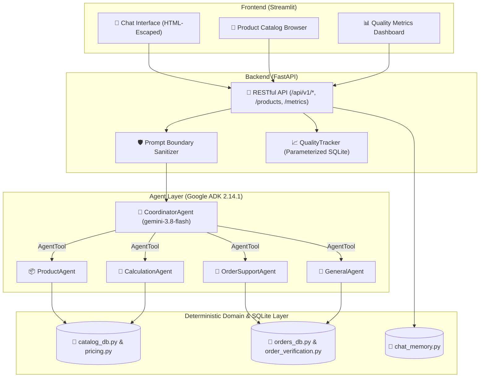

# 🏗️ Multi-Agent E-Commerce Support System - Architecture

> **Deterministic Multi-Agent Customer Support & Dispute Verification Architecture using Google ADK (`google-adk==2.14.1`)**

---

## 1. Architectural Invariant

**Probabilistic LLM reasoning is completely decoupled from financial arithmetic, inventory validation, state mutations, and payment/fulfillment evidence verification.**

* **Zero LLM-Supplied Prices or Discounts**: `CalculationAgent` never uses `BuiltInCodeExecutor` or floating-point math. It calls pure `decimal.Decimal` (`ROUND_HALF_UP`) functions (`calculate_quote`, `lookup_product`) in `backend/services/pricing.py` that resolve prices and allowlisted discount caps directly from SQLite (`backend/database/catalog_db.py`).
* **Deterministic Catalog Grounding**: `ProductAgent` never uses open web search (`google_search`). It queries the local SQLite catalog (`get_product_info`, `search_products`, `check_inventory`).
* **Evidence-Backed Dispute Verification**: `OrderSupportAgent` and `GeneralAgent` verify customer dispute claims (`charged_not_delivered`, `duplicate_charge`, `unauthorized_purchase`, `charged_but_denied`) against SQLite `PurchaseEvidence` (`x402`, `amount_cents`, `sim_usdc_micros`, `authorized_by_mandate`, `charge_count`) and `GrantEvidence` (`backend/services/order_verification.py`).
* **Immutable Prompt Boundary**: `CoordinatorAgent.instruction` is immutable; untrusted user queries and conversation history are sanitized against role-spoofing and XML tag breakouts (`sanitize_untrusted_text`) and passed via `InMemoryRunner.run_async` user messages.

---

## 2. Multi-Agent Topology

### Specialist Agents & Deterministic Tools

| Agent | Responsibility | Registered `FunctionTool` Wrappers | Backing Service / SQLite Module |
| :--- | :--- | :--- | :--- |
| **`CoordinatorAgent`** | Routes sanitized user turns to specialists; holds immutable system instructions. | `AgentTool(GeneralAgent)`, `AgentTool(OrderSupportAgent)`, `AgentTool(ProductAgent)`, `AgentTool(CalculationAgent)`, `lookup_order_status`, `verify_order_claim`, `escalate_to_human_support` | `backend/routers/chat.py` |
| **`ProductAgent`** | Catalog discovery, SKU lookup, and stock verification. | `get_product_info`, `search_products`, `check_inventory` | `backend/database/catalog_db.py`, `backend/services/pricing.py` |
| **`CalculationAgent`** | Cart subtotal, allowlisted discount code, and jurisdiction tax calculation. | `calculate_quote`, `lookup_product` (`_make_json_safe` wrapped) | `backend/services/pricing.py` (`Decimal` `ROUND_HALF_UP`, $10^2$ cents, $10^6$ `sim_usdc_micros`) |
| **`OrderSupportAgent`** | Order status, return eligibility, `x402` settlement evidence, and claim verification. | `lookup_order_status`, `verify_order_claim`, `escalate_to_human_support` | `backend/database/orders_db.py`, `backend/services/order_verification.py` |
| **`GeneralAgent`** | Greetings, general store inquiries, order lookups, and persisted ticket escalation. | `lookup_order_status`, `verify_order_claim`, `escalate_to_human_support` | `backend/services/order_verification.py` |

---

## 3. Data Layer & SQLite Persistence

All SQLite connections enforce `PRAGMA foreign_keys = ON` and `PRAGMA busy_timeout = 5000` inside context-managed connections (`contextlib.closing` / `@contextlib.contextmanager`):

1. **`chat_memory.py` (`SQLITE_DB_PATH`)**:
   * `chat_sessions`, `chat_messages` (`ON DELETE CASCADE`), `user_preferences`.
   * Chronological window retrieval (`ORDER BY id DESC LIMIT ?` wrapped in `ORDER BY id ASC`).
2. **`catalog_db.py` (`SQLITE_DB_PATH`)**:
   * `catalog_categories`, `products` (`price_cents`, `sim_usdc_micros`, `stock`), `discount_codes` (`WELCOME10`, `VIP15`, `SAVE5`, `EXPIRED20`).
3. **`orders_db.py` (`SQLITE_DB_PATH`)**:
   * `orders`, `order_evidence` (`PurchaseEvidence` & `GrantEvidence` JSON envelopes), `support_tickets`.
4. **`quality_tracker.py` (`QUALITY_DB_PATH`)**:
   * `quality_metrics` with parameterized SQL lookback windows, sub-agent attribution (`resolve_delegated_agent`), and `NaN`-safe summary aggregation.
