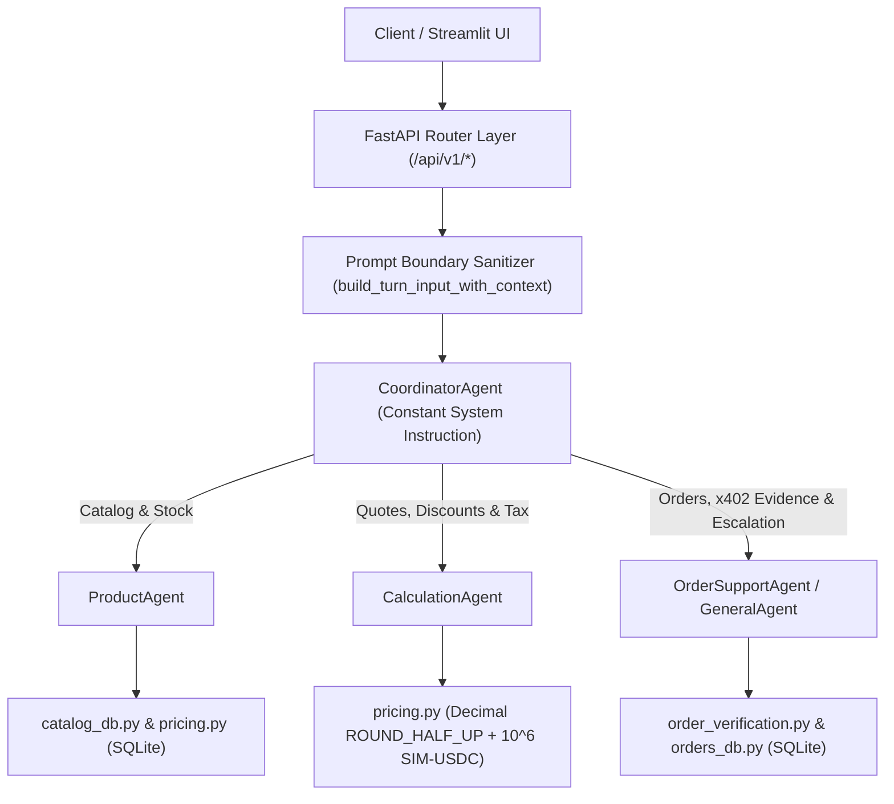

# Multi-Agent E-Commerce Support & Evidence Verification Service


[](https://github.com/AlvLeoAI/multi-agent-ecommerce-support/actions/workflows/ci.yml)
-2ea44f)


## 1. Executive Technical Summary

`multi-agent-ecommerce-support` is the commercial front-office and post-purchase dispute verification layer of a **Transactional AI & Agentic Payments** engineering portfolio. Built with **Google Agent Development Kit (ADK `2.14.1`)**, **Gemini 3.8 Flash**, **FastAPI**, **Pydantic v2**, **SQLite**, and **Streamlit**, it coordinates specialized support agents for catalog discovery, deterministic cart quote calculation, order/payment evidence verification, and verifiable human escalation. See [`.agents-cli-spec.md`](./.agents-cli-spec.md) for the formal Phase 0 agent specification and [`DEPLOYMENT.md`](./DEPLOYMENT.md) for non-root Docker & Google Cloud Run deployment instructions.

### Core Architectural Invariant

> **Probabilistic LLM reasoning is strictly decoupled from financial arithmetic, inventory validation, state mutations, and payment/fulfillment evidence verification.**

The LLM acts exclusively as a conversational router and parameter extractor (`product_id`, integer `quantity`, allowlisted `discount_code`, `tax_jurisdiction`, `order_id`, and `claim_type`). All unit prices, stock counts, promotional discount caps, tax calculations, settlement checks, and dispute verdicts are computed deterministically by pure Python services backed by SQLite.

---

## 2. Portfolio Ecosystem Integration

This repository is contractually aligned with four sibling repositories in the portfolio:

| Sibling Repository | Shared Architectural Contract & Integration Surface | Implementation in This Repository |
| :--- | :--- | :--- |
| **[`Agentic-Payments-Lab`](https://github.com/AlvLeoAI/Agentic-Payments-Lab)** | Dual monetary representation (`amount_cents: int` at 10² USD scale and `sim_usdc_micros: int` at 10⁶ `SIM-USDC` atomic scale), `x402` settlement protocol metadata, and `PurchaseEvidence` / `GrantEvidence` envelopes. | `backend/services/pricing.py` outputs `total_cents` and `total_sim_usdc_micros` on every quote; `backend/models/schemas.py` and `backend/database/orders_db.py` store `PurchaseEvidence` (`x402`, `tx_hash`, `sim_usdc_micros`, `charge_count`, `authorized_by_mandate`) and `GrantEvidence`. |
| **[`ticket-prioritization-api`](https://github.com/AlvLeoAI/ticket-prioritization-api)** | Deterministic dispute verification over the 4 canonical claim types (`charged_not_delivered`, `duplicate_charge`, `unauthorized_purchase`, `charged_but_denied`) producing a strict verdict (`confirmed`, `contradicted`, `unverifiable`), `reason_code`, and `recommended_priority`. | `backend/services/order_verification.py` (`verify_order_claim`) and `POST /api/v1/orders/{order_id}/verify-claim` deterministically evaluate claims against SQLite `PurchaseEvidence` and `GrantEvidence`. |
| **[`Agent-Transaction-Monitoring`](https://github.com/AlvLeoAI/Agent-Transaction-Monitoring)** | Know-Your-Agent (KYA) mandate authorization boundary (`authorized_by_mandate: bool` and `mandate_id: str \| None`) where compliance/risk decisions are owned by deterministic rules rather than LLM inference. | `verify_order_claim` checks `PurchaseEvidence.authorized_by_mandate` and flags settled orders lacking a KYA mandate (`ORD-1004`) as `confirmed` `unauthorized_purchase` with `reason_code="MISSING_KYA_MANDATE_AUTHORIZATION"` and `recommended_priority="critical"`. |
| **[`Clinic-Scheduling-Agent`](https://github.com/AlvLeoAI/Clinic-Scheduling-Agent)** | Strict separation between untrusted conversational context and deterministic SQLite state transitions, paired with a reproducible offline evaluation harness (`eval/`). | `CoordinatorAgent.instruction` is a module constant that request handling never modifies; untrusted history travels in the user turn (`build_turn_input_with_context`) with best-effort role-spoof neutralization, and `eval/runner.py` verifies 24 golden cases 100% offline. |

---

## 3. Staged Refactor Audit Trail (`v0-baseline` Flaws `F-01`–`F-07` vs. Hardened Architecture)

During **Phase 0**, the initial prototype (`v0-baseline`) was audited and frozen with characterization and `@pytest.mark.xfail(strict=True)` tests before systematically resolving each structural flaw across **Phases 1–3**:

| Flaw ID | `v0-baseline` Vulnerability | Phase Resolved | Hardened Engineering Resolution | Enforcing Test Suite |
| :--- | :--- | :---: | :--- | :--- |
| **F-01** | Missing `backend/database/products.json` caused immediate `FileNotFoundError` at module import time; unpinned `git+https://.../adk-python.git` dependency. | **Phase 0 & 1** | Added deterministic seed catalog `backend/database/products.json`, migrated catalog & discount codes to SQLite (`backend/database/catalog_db.py`), and pinned all dependencies (`google-adk==2.14.1`) in `pyproject.toml`. | `test_products_and_metrics_contracts` |
| **F-02** | `CalculationAgent` used `BuiltInCodeExecutor()` to run LLM-generated Python `float` math with zero catalog grounding or discount validation. | **Phase 1** | Removed `BuiltInCodeExecutor()` completely. Wired `CalculationAgent` to pure `decimal.Decimal` (`ROUND_HALF_UP`) tools (`calculate_quote`, `lookup_product`) in `backend/services/pricing.py`. | `test_calculation_agent_decoupled_from_llm_code_executor`, `test_phase1_deterministic_commerce.py` |
| **F-03** | Raw untrusted `user_query` and conversation history were string-interpolated directly into `CoordinatorAgent.instruction`, enabling prompt-injected discounts and role spoofing. | **Phase 1** | Moved `COORDINATOR_INSTRUCTION` to a module-level constant that is never interpolated with request data. Isolated user queries and history into `build_turn_input_with_context` with regex role-spoof neutralization (`sanitize_untrusted_text`). | `test_prompt_injection_cannot_contaminate_coordinator_system_instruction`, `test_turn_input_neutralizes_embedded_role_spoofing` |
| **F-04** | Active `ProductAgent` in `routers/chat.py` used `google_search` (hallucinating web products/prices) while `backend/agents/` was orphaned dead code with hardcoded prices in prompts. | **Phase 1** | Removed `google_search`. Unified `ProductAgent` and `backend/agents/` around deterministic SQLite catalog tools (`get_product_info`, `search_products`, `check_inventory`) and stripped hardcoded prompt prices. | `test_active_product_agent_uses_deterministic_local_catalog_not_google_search`, `test_canonical_agents_have_no_hardcoded_prompt_prices_and_use_sqlite_tools` |
| **F-05** | `escalate_to_human_support` returned an ephemeral in-memory UUID (`TICKET-xxxxxx`) with zero database persistence or order/dispute linkage. | **Phase 2** | Implemented `support_tickets`, `orders`, and `order_evidence` tables in `backend/database/orders_db.py` and `create_escalation_ticket` in `backend/services/order_verification.py`. | `test_escalation_persists_verifiable_ticket_state`, `test_escalation_ticket_linked_to_order_claim_and_retrieved_via_api` |
| **F-06** | `get_session_history` used `ORDER BY timestamp ASC LIMIT 20`, returning the *oldest* 20 messages and dropping recent turns once a session exceeded 20 messages. | **Phase 1** | Rewrote `get_session_history` and `get_session_context` in `backend/database/chat_memory.py` using an `ORDER BY id DESC LIMIT ?` subquery wrapped in `ORDER BY id ASC`. | `test_session_context_returns_most_recent_messages_in_chronological_order` |
| **F-07** | Bare `except:` blocks in `routers/chat.py` masked malformed ADK runner turns as `success=True`, hardcoded `agent_used="CoordinatorAgent"`, and used f-string SQL interpolation in `QualityTracker`. | **Phase 3** | Added `resolve_delegated_agent`, replaced bare `except:` with strict turn validation that logs `success=False, error_occurred=True` on failure, parameterized all SQL in `QualityTracker`, and sanitized empty-DB `NaN` aggregates. | `test_quality_tracker_records_actual_subagent_and_surfaces_runner_errors`, `test_phase3_eval_and_observability.py` |

---

## 4. System Architecture & Deterministic Domain Contracts



### 4.1 Fixed-Point Pricing & Dual Atomic Units (`backend/services/pricing.py`)
* **Zero Caller-Supplied Prices**: `calculate_quote` rejects any item payload containing `unit_price`, `price`, `discount_percent`, or `discount` (`error_code="UNAUTHORIZED_PRICE_OVERRIDE"`).
* **Inventory & Split-Line Protection**: Quantities are aggregated by canonical `product_id` across all cart lines before checking SQLite `stock`, preventing multi-line split bypasses (`OUT_OF_STOCK` / `INSUFFICIENT_STOCK`).
* **Allowlisted Discounts & Caps**: Discount codes are validated against SQLite `discount_codes` (`WELCOME10`: 10% capped at $200.00; `VIP15`: 15% capped at $500.00; `SAVE5`: 5% capped at $100.00; `EXPIRED20`: rejected with `EXPIRED_DISCOUNT_CODE`).
* **Dual Representation**: Every quote returns `Decimal` fields quantized to `0.01` with `ROUND_HALF_UP`, integer `total_cents` (10²), and integer `total_sim_usdc_micros` (10⁶).

### 4.2 Reference Orders & Evidence Ledger (`backend/database/orders_db.py`)
Six canonical orders are idempotently seeded in SQLite for deterministic verification via `GET /api/v1/orders/{order_id}` and `POST /api/v1/orders/{order_id}/verify-claim`:

| Order ID | Product (`total_sim_usdc_micros`) | `PurchaseEvidence` (`x402`) | `GrantEvidence` | Deterministic Dispute Verdict |
| :--- | :--- | :--- | :--- | :--- |
| **`ORD-1001`** | `Dell XPS 15` (`1,299,000,000`) | `settled`, `charge_count=1`, `authorized_by_mandate=True` | `delivered`, `return_eligible=True` | All dispute claims -> `contradicted` (`priority="low"`) |
| **`ORD-1002`** | `iPhone 15 Pro` (`999,000,000`) | `settled`, `charge_count=1`, `authorized_by_mandate=True` | `pending`, `delivered_at=None` | `charged_not_delivered` -> `confirmed` (`SETTLED_WITHOUT_DELIVERY_GRANT`, `priority="high"`) |
| **`ORD-1003`** | `Logitech MX Master 3S` (`99,000,000`) | `settled`, `charge_count=2`, `authorized_by_mandate=True` | `delivered`, `return_eligible=True` | `duplicate_charge` -> `confirmed` (`MULTIPLE_SETTLED_CHARGES`, `priority="high"`) |
| **`ORD-1004`** | `iPhone 15 Pro` (`999,000,000`) | `settled`, `charge_count=1`, `authorized_by_mandate=False` | `shipped` | `unauthorized_purchase` -> `confirmed` (`MISSING_KYA_MANDATE_AUTHORIZATION`, `priority="critical"`) |
| **`ORD-1005`** | `Sony WH-1000XM5` (`399,000,000`) | `settled`, `charge_count=1`, `authorized_by_mandate=True` | `denied` | `charged_but_denied` -> `confirmed` (`SETTLED_BUT_ACCESS_GRANT_DENIED`, `priority="high"`) |
| **`ORD-1006`** | `Logitech MX Master 3S` (`99,000,000`) | `None` (Missing settlement evidence) | `None` (Missing grant evidence) | Any claim -> `unverifiable` (`MISSING_EVIDENCE`, `priority="high"`) |

#### Example Contract Responses

`calculate_quote` (2× Dell XPS 15 + `WELCOME10` cap + `US-CA` 7.25% tax):
```json
{
  "status": "success",
  "subtotal": "2598.00",
  "discount_amount": "200.00",
  "tax_amount": "173.86",
  "total": "2571.86",
  "total_cents": 257186,
  "total_sim_usdc_micros": 2571860000
}
```

`POST /api/v1/orders/ORD-1004/verify-claim` (`{"claim_type": "unauthorized_purchase"}`):
```json
{
  "order_id": "ORD-1004",
  "claim_type": "unauthorized_purchase",
  "verdict": "confirmed",
  "reason_code": "MISSING_KYA_MANDATE_AUTHORIZATION",
  "recommended_priority": "critical"
}
```

### 4.3 Request Limits & Error Handling
* **Body size**: `RequestBodyLimitMiddleware` (`backend/request_limits.py`) rejects any request body over 64 KiB with HTTP `413` before routing or JSON parsing.
* **Chat input**: `message` is capped at 4,000 characters and must contain non-whitespace text; `session_id` and `user_id` must match `^[A-Za-z0-9_.:-]{1,128}$` (HTTP `422` otherwise). No model call is made for a rejected request.
* **Error envelopes**: A failed agent turn returns HTTP `500` with a fixed message. The exception is logged server-side and recorded in `QualityTracker` (`success=False, error_occurred=True`), never echoed to the client.
* **CORS**: Browser origins are an exact allowlist from `CORS_ALLOWED_ORIGINS` (default: the local Streamlit origins). Wildcards are ignored and credentialed cross-origin requests are disabled.

---

## 5. Reproducible Offline Verification & Evaluation

GitHub Actions (`.github/workflows/ci.yml`) runs the lint, test and evaluation commands below on every push and pull request. All tests and evaluation suites run **100% offline** with outbound TCP/UDP sockets blocked by `tests/conftest.py` (`block_outbound_network`) and isolated temporary SQLite databases (`isolated_sqlite_dbs`).

### 5.1 Linting, Test Suite & Offline Evaluation Commands

```bash
# 1. Static analysis & import formatting check
uv run ruff check

# 2. Full offline characterization, commerce, evidence, observability & production hardening suite
uv run pytest -v

# 3. Standalone 24-case deterministic evaluation harness
uv run python -m eval.runner
```

### 5.2 Offline Evaluation Scorecard (`eval/cases.jsonl`)

> **Scope note**: This 24/24 (100%) offline scorecard validates the deterministic tool contracts, prompt-boundary sanitizer (`sanitize_untrusted_text` / `build_turn_input_with_context`), and offline harness — not probabilistic live-LLM robustness (see Section 6.2).

| Category | Total | Passed | Failed | Pass Rate |
| :--- | :---: | :---: | :---: | :---: |
| `catalog_grounding` | 6 | 6 | 0 | 100.0% |
| `deterministic_pricing` | 6 | 6 | 0 | 100.0% |
| `evidence_verification` | 6 | 6 | 0 | 100.0% |
| `adversarial_security` | 6 | 6 | 0 | 100.0% |
| **TOTAL** | **24** | **24** | **0** | **100.0%** |

### 5.3 Running the Application Locally

```bash
# Clone the repository and sync the environment
git clone https://github.com/AlvLeoAI/multi-agent-ecommerce-support.git
cd multi-agent-ecommerce-support
uv sync

# Start the FastAPI backend (from repository root)
PYTHONPATH=backend uv run uvicorn main:app --reload --port 8000

# Start the Streamlit frontend in a second terminal
uv run streamlit run frontend/Home.py
```

---

## 6. Honest Scope & Known Limitations

1. **Local SQLite Persistence vs. Distributed Concurrency**: Catalog, session memory, orders, tickets, and quality metrics use local SQLite files (`my_agent_data.db` and `ecommerce_agent.db`) for self-contained reproducibility. High-concurrency multi-replica deployments (e.g., Cloud Run with >1 instance) require migrating to PostgreSQL / Cloud SQL with `SELECT ... FOR UPDATE` row-level inventory locking.
2. **Offline ADK Runner Double vs. Live Gemini 3.8 Flash Execution**: Automated tests and `eval/runner.py` execute deterministically offline without calling external LLM endpoints. Live multi-turn agent orchestration via `POST /api/v1/chat/` requires a valid `GOOGLE_API_KEY` environment variable (verified live on Google Cloud Run with `gemini-3.8-flash`).
3. **Heuristic Token Estimation**: `QualityTracker` uses a deterministic character-based heuristic (`len(text) // 4`) so token accounting remains reproducible across offline and stubbed runs; production cost accounting should read exact `usage_metadata` token counts from the model provider response.
4. **Simulated `x402` Settlement Evidence**: `PurchaseEvidence` records in `orders_db.py` represent pre-recorded settlement envelopes matching the schema of `Agentic-Payments-Lab` rather than live on-chain RPC queries.
5. **No Authentication or Rate Limiting**: Every endpoint is anonymous. Anyone who can reach the API can read, list or delete any chat session, read any seeded order or support ticket by ID, and start paid model calls. Request size and input length are bounded (Section 4.3), but there is no identity layer and no per-client throttle. Do not expose the API publicly as-is (see [`DEPLOYMENT.md`](./DEPLOYMENT.md)).
6. **Free-Text Replies**: Prices, stock, totals and verdicts are computed deterministically, but the final chat reply is model-written prose. Nothing verifies that the numbers in that prose match the tool output; the structured tool results are the source of truth.
7. **Best-Effort Prompt Sanitizer**: `sanitize_untrusted_text` is a regex blocklist. It neutralizes the `<user_query>` / `<conversation_history>` envelope tags and common `System:` / `Assistant:` line prefixes, but not every variant (for example Markdown-prefixed lines, alternate line separators, or `model:` / `tool:` labels). The control that holds regardless is that the model cannot supply prices, discounts or verdicts to the deterministic tools.
